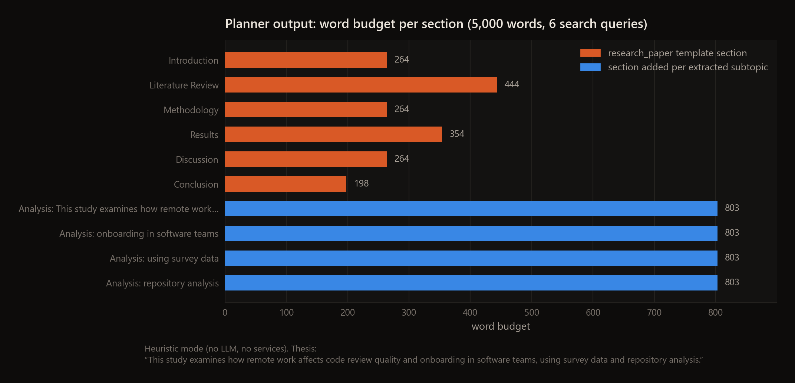
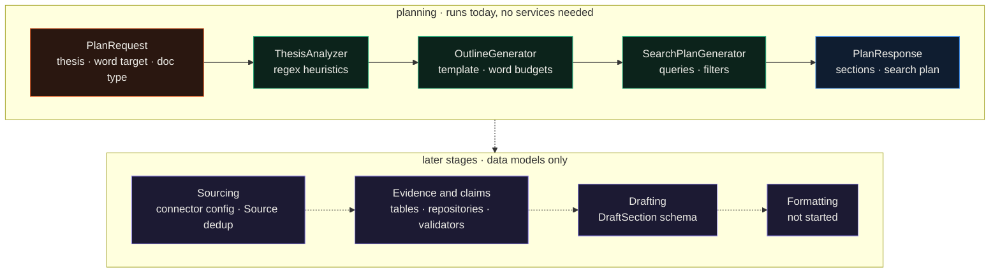
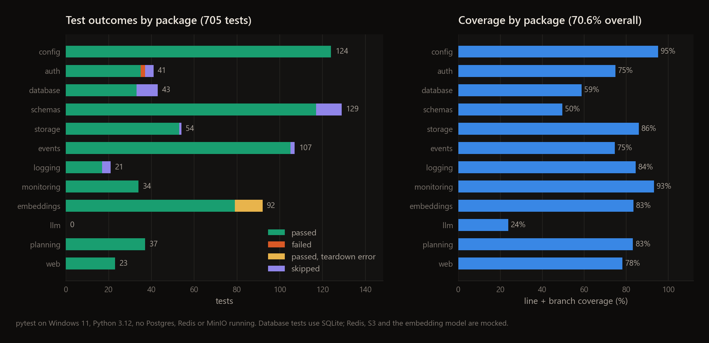

<div align="center">

# PenEllE

**An experimental Python pipeline that turns a thesis into a section plan with word budgets and search queries, the first stage of a cited-document generator.**




</div>

I built PenEllE in 2025 to go from a thesis and a run config to a cited research document: plan the sections, find sources, extract typed evidence, draft, then format. It is an experiment and it stops early. Planning works today without any LLM or running services. Sourcing, evidence extraction, drafting and formatting exist only as database tables, JSON Schemas and validators, with no code yet that does the work.

---

## Highlights

- The planner turns a thesis into a sectioned outline, word budgets and a search plan in about 3 ms with no LLM, database or network. The thesis in the figure above gives 10 sections, 5,000 words, 6 search queries and an estimate of 70 sources.
- Every artifact the later stages would produce already has a contract: 12 JSON Schemas with matching Pydantic models (source, evidence, claim, draft section, quality report, run manifest and others) plus validators for runs, sources, evidence, claims and outputs.
- The Postgres layer defines 14 tables with async SQLAlchemy repositories. Sources are deduplicated by a SHA-256 fingerprint of the DOI, or of title, authors and year when there is no DOI, and claims link to evidence through a join table with a graph query on top.
- Hybrid retrieval scores documents as `alpha * semantic + (1 - alpha) * BM25` over sentence-transformer embeddings stored in pgvector, with `alpha = 0.5` by default. It is unit-tested, but no stage calls it yet.
- The 705 tests run in about a minute with no services (SQLite and mocks). 670 pass and line plus branch coverage is 70.6%.

## How it works



`PlanningService` runs three steps in order, all in `src/services/planning/`.

1. `ThesisAnalyzer` pulls a main topic, subtopics, research questions, key concepts, a scope label and methodology hints out of the thesis with regular expressions. Subtopics come from enumerations and from splitting on "and"; research questions come from literal questions and phrases like "to examine X"; concepts come from quoted terms, capitalised phrases, a fixed term list and patterns like "X framework".
2. `OutlineGenerator` picks one of four templates (`research_paper`, `essay`, `literature_review`, `report`), gives each section a weight, adds one "Analysis: <subtopic>" section per subtopic when the target is over 3,000 words, then rescales every budget so the total hits the target.
3. `SearchPlanGenerator` builds up to 20 queries (main topic, research questions, key concepts, per-section templates, user keywords) sorted by priority, adds filters (published on or after 2018-01-01, English, articles and reviews, plus books and dissertations for broad theses), and estimates about 7 sources per section, clamped to 20 to 100.

Each step has an LLM branch that asks a model for JSON and falls back to the heuristics on a parse error, but `PlanningService` constructs all three with `use_llm=False`.

## Status by stage

| Stage | State | Where in `src/` |
|---|---|---|
| Input (thesis and run config) | **works** for planning: `PlanRequest` checks thesis length (10 to 5,000 chars) and a word target of at least 500. The fuller `RunConfiguration` schema is not wired to anything. | `services/planning/models.py`, `core/schemas/` |
| Planning | **works**, heuristic only. The LLM branch is switched off and fails if switched on (see Limitations). | `services/planning/` |
| Sourcing | stub. Five connectors are configured (OpenAlex, Semantic Scholar, PubMed, arXiv, Crossref) but there is no client code. `SourceRepository` stores and deduplicates CSL-JSON records. | `config/connectors.yaml`, `core/database/repositories/source.py` |
| Retrieval and parsing | partial. `FileProcessor.process_pdf` reads PDF metadata and a 500-character first-page preview; the S3/MinIO client and artifact store are tested against mocks. | `core/storage/` |
| Evidence extraction | stub. Table, repository, JSON Schema and validator; nothing extracts evidence. | `core/database/`, `core/schemas/validators/evidence_validator.py` |
| Claims and fact-check | stub. `Claim` and `ClaimEvidence` tables, a claim graph query and `ClaimValidator`; nothing generates claims. | `core/database/repositories/claim.py`, `core/schemas/validators/` |
| Drafting | not started. `DraftSection` schema and validator only. | `core/schemas/` |
| Formatting | not started. An `OutputFormat` enum; python-docx, pandoc and beautifulsoup4 are in `requirements.txt` but never imported. | `core/config/models.py` |

The supporting pieces are further along than the stages that would use them:

| Component | State | Where in `src/` |
|---|---|---|
| HTTP API | `/health`, `/docs`, `/v1/planning/templates/{type}` and `/v1/planning/plan/validate` work. `POST /v1/planning/plan` returns 500. | `web/` |
| LLM providers | Ollama is implemented; OpenAI and Anthropic raise `NotImplementedError`. | `core/llm/` |
| Embeddings and hybrid search | sentence-transformers, pgvector store, BM25; tested with mocks, unused. | `core/embeddings/` |
| Event bus | Redis Streams with consumer groups, retries and replay; tested with a mocked client. | `core/events/` |
| Auth | JWT, bcrypt password hashing, roles and permissions; no route uses them. | `core/auth/` |
| Config, logging, metrics | YAML loader with `${VAR:-default}` substitution, structlog with secret redaction, Prometheus metrics. | `core/config/`, `core/logging/`, `core/monitoring/` |

## Quickstart

These are the commands I ran on Windows 11 with Python 3.12. The project needs Python 3.11 or newer (it uses `datetime.UTC`).

```bash
git clone https://github.com/EllE961/PenEllE.git
cd PenEllE
python -m venv .venv
.venv\Scripts\activate            # Linux/macOS: source .venv/bin/activate
pip install -r requirements.txt   # pulls torch and sentence-transformers, a large download
```

Plan a document from the repo root. No database, Redis or model is needed:

```python
import asyncio
from src.services.planning import PlanningService, PlanRequest

request = PlanRequest(
    thesis="This study examines how remote work affects code review quality and onboarding "
           "in software teams, using survey data and repository analysis.",
    target_word_count=5000,
)
plan = asyncio.run(PlanningService().plan(request))
for s in plan.sections:
    print(s.order, s.title, s.word_budget)
print(len(plan.search_plan.queries), "search queries,", plan.search_plan.total_expected_sources, "expected sources")
```

```text
1 Introduction 264
2 Literature Review 444
3 Methodology 264
4 Results 354
5 Discussion 264
6 Conclusion 198
20 Analysis: This study examines how remote work affects code review quality 803
21 Analysis: onboarding in software teams 803
22 Analysis: using survey data 803
23 Analysis: repository analysis 803
6 search queries, 70 expected sources
```

The service also prints structlog JSON lines to stdout. To start the API:

```bash
uvicorn src.web.app:app
```

`GET /health` returns `{"status":"healthy"}` and the Swagger page is at http://127.0.0.1:8000/docs. `POST /v1/planning/plan` returns 500 for the reasons under Limitations, so use the Python call above to get a plan.

## Configuration

Behaviour is set by the YAML files in `config/` (`deployment`, `models`, `pipeline`, `connectors`, `quality_gates`). `.env.example` lists the environment variables the project was meant to use, but nothing loads a `.env` file and most of them are not read yet:

| Variable | Read by | Notes |
|---|---|---|
| `DATABASE_URL` | Alembic `env.py` | overrides `sqlalchemy.url` in `alembic.ini`; the app's `DatabaseManager` does not read it |
| `REDIS_URL` | `config/deployment.yaml`, then `EventBus` | defaults to `redis://localhost:6379/0` |
| `OPENAI_API_KEY`, `ANTHROPIC_API_KEY` | `config/models.yaml` | substituted into model entries; both providers are placeholders |
| `OLLAMA_HOST` | nothing | the Ollama URL comes from `api_base` in `config/models.yaml` |
| `ENV`, `DEBUG`, `DATABASE_POOL_SIZE`, `DATABASE_MAX_OVERFLOW`, `REDIS_MAX_CONNECTIONS`, `S3_*`, `JWT_*`, `SECRET_KEY`, `API_*`, `CORS_ORIGINS`, `ALLOWED_HOSTS`, `SECURE_HEADERS_ENABLED`, `LOG_*`, `OTEL_*`, `FEATURE_*`, `TEST_*` | nothing | the values in use are hardcoded, mostly in `src/core/config/__init__.py` |

Two more: `TESTING=true` stops `src/core/database/connection.py` from creating its module-level `DatabaseManager` on import, and `config/connectors.yaml` substitutes `OPENALEX_EMAIL`, `SEMANTIC_SCHOLAR_API_KEY`, `PUBMED_EMAIL` and `CROSSREF_EMAIL`, which no code reads yet.

## Testing

I ran the suite on Windows 11 with Python 3.12.10 and nothing else running (Docker was off, so no Postgres, Redis or MinIO). Database tests use SQLite through aiosqlite; Redis, S3 and the sentence-transformer model are mocked.

```bash
pytest --cov=src --cov-report=json --junitxml=junit.xml
python scripts/make_figures.py
```

| Outcome | Tests |
|---|---|
| passed | **670** |
| failed | 2 |
| skipped | 33 |
| errors at teardown | 13 |
| collected | 705 |

- The 2 failures are `test_hash_password` and `test_verify_password`: passlib 1.7.4 breaks on bcrypt 5.x, which `requirements.txt` does not pin. With `bcrypt==4.0.1` all 21 tests in `tests/core/test_auth.py` pass.
- The 13 errors are in `tests/core/embeddings/test_cache.py`. Each test passes, then the fixture tries to delete a SQLite file that is still open, which Windows refuses.
- The 33 skips are hardcoded markers: 14 database and RBAC tests that hit SQLite table-creation or lazy-loading problems, 12 schema integration tests marked as needing a rewrite, 4 logging tests, 2 that need Redis and 1 that needs MinIO.
- Coverage is 70.6% counting lines and branches (5,396 of 7,079 statements, 76.2%). `src/core/llm` is lowest at 24% because nothing tests the providers.
- `test_core_config_py.py::test_llm_settings` fails if `ANTHROPIC_API_KEY` is set in your shell; I ran with it unset.
- `pytest.ini` uses a `[tool:pytest]` header, so pytest treats it as an empty config and ignores the options in it and in `pyproject.toml`. Pass `--cov` explicitly as above. Async tests carry their own `asyncio` markers, so they still run.



## Repository map

```text
PenEllE/
├── src/
│   ├── services/planning/   # thesis analysis, outline, search plan: the stage that runs
│   ├── core/
│   │   ├── schemas/         # 12 JSON Schemas, Pydantic models, validators
│   │   ├── database/        # SQLAlchemy models, async repositories, Alembic migrations 001 to 003
│   │   ├── embeddings/      # sentence-transformers, pgvector store, BM25 hybrid search
│   │   ├── events/          # Redis Streams event bus and handlers
│   │   ├── storage/         # S3/MinIO client, artifact store, PDF metadata
│   │   ├── llm/             # provider interface; only Ollama is implemented
│   │   ├── auth/            # JWT, password hashing, RBAC
│   │   ├── config/          # YAML loader with env var substitution
│   │   ├── logging/         # structlog setup with secret redaction
│   │   └── monitoring/      # Prometheus metrics
│   └── web/                 # FastAPI app and /v1/planning routes
├── config/                  # deployment, models, pipeline, connectors, quality gates
├── alembic/versions/        # user and RBAC migrations, not on the configured path
├── tests/                   # 705 pytest tests
├── scripts/make_figures.py  # regenerates the figures in docs/assets
├── docker-compose.test.yml  # Postgres (pgvector), Redis and MinIO for tests
└── .github/workflows/ci.yml # CI, manual trigger only
```

## Limitations

- Only planning produces output. Everything after it is a schema, a table or a validator waiting for the code that would fill it.
- `POST /v1/planning/plan` returns 500. The route builds `PlanningService` with the Redis event bus, so without Redis the first publish fails. With Redis up it would still fail: the planner publishes Pydantic `BaseEvent` objects, and `EventBus.publish` calls `to_dict()`, which they don't have. The API tests mock `PlanningService`, so they don't catch this.
- LLM mode does not work. `PlanningService` hardcodes `use_llm=False`, and turning it on raises `AttributeError` because `LLMClient(model_name=...)` reads `.pipeline` from the plain dict that `load_config` returns. The default models in `config/pipeline.yaml` are OpenAI and Anthropic entries whose providers are placeholders anyway. I made no model calls for this write-up.
- The word budgets are skewed. Template weights are multiplied by the per-section average instead of the total, while subtopic sections take a flat 30% of the target, so after rescaling each subtopic section gets 803 words against 198 to 444 for the core sections. Splitting on "and" also produces subtopics like "using survey data".
- Settings are hardcoded test values in `src/core/config/__init__.py`, including the database URL, the JWT signing key and MinIO credentials. The env-driven `Settings` class in `src/core/config.py` is shadowed by the package of the same name. CORS allows every origin with credentials.
- Migrations are incomplete. `001_initial_schema` is a no-op that expects the tables to come from the SQLAlchemy models, the configured path (`src/core/database/migrations`) only adds event logs, embeddings and search history, and the user and RBAC migrations in `alembic/versions` reuse revision id 003 and are not on that path. I did not run Alembic because I had no Postgres.
- `docker-compose.test.yml` mounts `scripts/init-test-db.sql` and `scripts/init-vector-db.sql`, which are not in the repo.
- The CI workflow only runs on manual dispatch. It needs Postgres, Redis and MinIO service containers, and the two bcrypt failures would fail it on every push.

## License

MIT, see [LICENSE](LICENSE).
